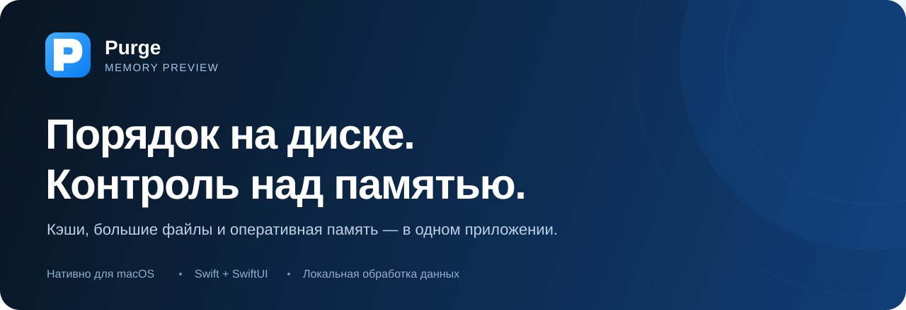

<div align="center">
  
  <br /><br />
  <p><strong>Понятная очистка диска и управление оперативной памятью на Mac.</strong></p>
  <p>Посмотрите, что занимает место, разберите лишнее и следите за памятью — с объяснениями перед важными действиями.</p>
  <p>
    <a href="https://github.com/Alex-dev-sys/purge-memory-preview/releases"><strong>Скачать для macOS →</strong></a>
    &nbsp; · &nbsp;
    <a href="#install">Установка</a>
    &nbsp; · &nbsp;
    <a href="#memory">Память</a>
    &nbsp; · &nbsp;
    <a href="#build-from-source">Сборка из исходников</a>
  </p>
  <p>
    <a href="https://github.com/Alex-dev-sys/purge-memory-preview/actions/workflows/memory-preview.yml"></a>
    
    
    <a href="LICENSE"></a>
  </p>
  <p><strong>Русский</strong> · <a href="README.zh-CN.md">简体中文</a></p>
</div>

---

**Purge Memory Preview** — форк [Purge](https://github.com/jithin-sabu/purge-app) с разделом оперативной памяти, русским интерфейсом и предварительными сборками через GitHub Actions. Нативное приложение на Swift и SwiftUI; сканирование и обработка данных выполняются на вашем Mac.

## Что умеет Purge

| Раздел | Возможности |
| --- | --- |
| **Обзор** | Занятое и свободное место, распределение по категориям и карта прочих данных, доступная только для просмотра. |
| **Кэши приложений** | Кэши, логи, отчёты о сбоях и поддерживаемые системные остатки — с объяснениями и оценкой безопасности. |
| **Разработка** | Кэши инструментов, папки сборки и зависимостей, неиспользуемые симуляторы и их среды выполнения. Активные проекты и зарегистрированные Git worktree защищены. |
| **Большие файлы** | Поиск и фильтры, локальные AI-модели, виртуальные машины, поиск дубликатов по содержимому, Quick Look и открытие в Finder. |
| **Удаление приложений** | Приложения, связанные файлы, остатки удалённых программ и инструменты командной строки — с предварительным просмотром. |
| **Память** | Оценка использования RAM, приложения вместе со вспомогательными процессами, очистка файлового кэша и история действий. |

<a id="install"></a>

## Установка

1. Откройте [страницу релизов](https://github.com/Alex-dev-sys/purge-memory-preview/releases) и скачайте `Purge-Memory-Preview-…dmg` из завершённого предварительного выпуска. Один образ подходит для **Apple silicon и Intel**.
2. Перетащите **Purge Memory Preview** в **Программы** и запустите приложение.
3. Если macOS запросит подтверждение открытия приложения вне App Store, подтвердите запуск.
4. При необходимости предоставьте **полный доступ к диску**. Без него доступны ограниченные проверки; приложение показывает, какие места не удалось прочитать.

> [!NOTE]
> Это предварительная версия с временной подписью, без нотариального заверения Apple. Она использует отдельные идентификаторы, настройки, данные и имена вспомогательных служб. Обновления устанавливаются из релизов этого репозитория; upstream-обновлятор Sparkle отключён. Homebrew-пакет оригинального Purge устанавливает другую версию приложения.

<details>
<summary><strong>Как проверить скачанный файл</strong></summary>

Сохраните `SHA256SUMS.txt` рядом с DMG и выполните:

```bash
cd ~/Downloads
shasum -a 256 -c SHA256SUMS.txt
```

Результат `OK` подтверждает совпадение файла с опубликованной контрольной суммой.

</details>

### Русский интерфейс

Откройте **Настройки → Основные → Язык**, выберите **Русский** и нажмите **Перезапустить Purge**. Перезапуск недоступен во время очистки или действия с процессами.

Переведены интерфейс, объяснения безопасности, действия Finder и Siri и формы множественного числа. Можно выбрать английский или язык системы; упрощённый китайский доступен через системный язык. Язык macOS при этом не меняется.

<a id="memory"></a>

## Память — состояние, приложения и действия

Откройте **Память** сочетанием **⌘6**. На странице видны оценка занятой RAM, разбивка по категориям и сворачиваемый список приложений с их вспомогательными процессами. Приложения, которым можно отправить подтверждённый запрос завершения, показаны первыми. В каждой группе доступна сортировка по имени или памяти.

**Очистить память** просит macOS освободить доступные для сброса страницы файлового кэша через системную команду `purge`. Работающие приложения остаются открытыми; файлы на диске сохраняются. Для этой функции используется отдельная служба: её включение требует подтверждения в штатном окне администратора. Пароль не сохраняется; служба выполняет только фиксированную команду очистки.

> [!IMPORTANT]
> macOS сама управляет RAM. Малое количество свободной памяти само по себе не означает проблему. Очистка файлового кэша не освобождает живые выделения приложений и не снижает использование RAM до заданного процента. Кэш может заполниться снова, а повторное чтение файлов — временно замедлиться.

После очистки Purge сравнивает свободную память до и после запроса и сохраняет результат в **истории памяти**. Это наблюдаемое изменение: другие приложения в тот же момент тоже могут выделять и освобождать RAM. Если прироста нет или замеры нельзя сопоставить, приложение сообщает об этом без выдуманного количества освобождённых байтов.

### Автоочистка — по вашему выбору

По умолчанию автоочистка **выключена**. Настройки находятся в **Настройки → Память**.

| Режим | Доступные значения | Условие запуска |
| --- | --- | --- |
| **По таймеру** | 5, 15, 30 или 60 минут | После выбранного интервала, пока Purge запущен и доступен для очистки. |
| **По использованию RAM** | 70%, 80%, 85%, 90% или 95% | Оценка занятой памяти удерживается не ниже порога 30 секунд. |

Начальные значения — **30 минут** и **85%**. Процент задаёт условие попытки очистки, а не целевое использование RAM после неё.

<details>
<summary><strong>Интервалы, сон и ограничения автоматических действий</strong></summary>

Между автоматическими попытками проходит не менее пяти минут. Повторное срабатывание по RAM возможно после снижения использования на пять процентных пунктов ниже порога. Системная служба дополнительно отклоняет запросы с интервалом менее 60 секунд.

Во время очистки диска или действия с процессами ручная очистка памяти недоступна, а автоматическая откладывается. На время сна автоматические попытки приостанавливаются. Чтобы оставить функцию доступной после закрытия окна, включите **Оставлять Purge в строке меню**. После выхода из приложения запросы прекращаются: расписание не запускает Purge самостоятельно.

Оценка занятой RAM включает память приложений, системную неперемещаемую память и сжатую память. Поэтому освобождение файлового кэша может увеличить свободную память без заметного изменения этого процента.

</details>

<details>
<summary><strong>Обновление показателей, уведомления и завершение приложений</strong></summary>

Общие показатели обновляются раз в одну или две секунды. Подробности процессов — раз в пять секунд, пока страница памяти активна, окно видно и список раскрыт. В фоне и при свёрнутом списке регулярного опроса процессов нет. Можно отдельно включить индикатор в строке меню и уведомления о длительном повышенном или критическом давлении на память; обе функции изначально выключены.

Уведомление требует разрешения macOS и отправляется после 60 секунд выбранного уровня давления. Если macOS ещё не сообщила состояние памяти, индикатор состояния скрыт. Общесистемные категории RAM и оценка памяти группы процессов — разные показатели; их нельзя считать точными долями одного и того же числа.

**Завершить** и **Принудительно завершить** — отдельные действия с подтверждением. Они доступны только для распознанных пользовательских приложений. Системные процессы, сам Purge и его помощники, исключённые приложения и цели, не прошедшие проверку идентичности, защищены. Обычное завершение не превращается в принудительное автоматически. Эти действия не используются при очистке памяти; принудительное завершение может привести к потере несохранённой работы.

</details>

<a id="disk-tools"></a>

## Очистка диска с понятными границами

Кнопка **Безопасная очистка** объединяет подходящие результаты из кэшей приложений и инструментов разработки. Для диска также можно настроить отдельное расписание.

| Метка | Как с ней работать |
| --- | --- |
| **Безопасно очистить** | Подходящие элементы могут участвовать в безопасной и плановой очистке. |
| **Сначала проверить** | Посмотрите описание и содержимое перед выбором действия. Автоматическая безопасная очистка их пропускает. |
| **Неизвестно** | Может встречаться в подтверждении удаления; требует отдельной проверки. |

Большие файлы считаются личными данными и **не участвуют в автоматической безопасной очистке**. Действие **Оставить только в iCloud** отдельно убирает локальную копию полностью синхронизированного файла, сохраняя его в iCloud, и требует предварительного просмотра.

На поддерживаемых Mac в обзоре доступны локальные снимки Time Machine и управление моделями Apple Intelligence. Удаление моделей требует **macOS 27 и Apple silicon**; повторная загрузка запрашивает у службы Apple те наборы, которые удалил Purge.

<details>
<summary><strong>Что можно восстановить и какие действия обходят корзину</strong></summary>

По умолчанию файлы и папки перемещаются в **Корзину**. Purge не очищает её; пока вы не сделали это сами, файлы можно восстановить.

Некоторые действия выполняет другая система или программа, и корзина не используется:

| Объект | Способ удаления |
| --- | --- |
| Симуляторы iOS и среды выполнения | Через `simctl` из Xcode. |
| Локальные снимки Time Machine | Через `tmutil`. Самый новый снимок и последний снимок из резервного копирования сохраняются. |
| Модели Apple Intelligence | Через службу ресурсов Apple; модели можно загрузить повторно. |
| Инструменты командной строки и приложения Homebrew cask | Через пакетный менеджер, если вы выбрали этот вариант в окне проверки. |

Удаление симуляторов, их сред, снимков и программ через пакетный менеджер не переносит их в корзину. Последствия описаны в подтверждении. Папка данных Docker Desktop перемещается в корзину; команда `docker system prune` не запускается.

</details>

<a id="performance"></a>

## Меньше лишней работы

Обновления больших списков объединяются, сортировка вынесена с главного потока, а запущенные процессы измерения размеров можно отменить. Мониторинг процессов останавливается при сворачивании списка; выключенная автоочистка не держит активный таймер.

| Обработка 10 000 результатов Large Files | До | После |
| --- | ---: | ---: |
| Время | 738 мс | **215 мс** |
| Процессорное время | 825 мс | **302 мс** |
| Публикации списка | 403 | **4** |

Это медианы пяти повторов в Release на **Apple M1, 8 ГБ RAM**. Измерялась обработка одинаковых готовых результатов без обхода диска и отрисовки интерфейса. Эти цифры не означают ускорение всего сканирования в том же отношении. Устойчивое снижение потребления RAM и CPU в простое не установлено.

[Методика, ограничения и исходные измерения →](docs/benchmarks/2026-11-10/README.md)

<a id="build-from-source"></a>

## Для разработчиков

**Требования:** macOS 13+, Xcode 26+ с возможностями Swift 6.2, Python 3 и Node.js для проверок репозитория. Зависимости npm нужны только для пересборки иконок сторонних брендов.

<details>
<summary><strong>Собрать и запустить локальную preview-версию</strong></summary>

Используйте отдельную копию репозитория: скрипт конфигурации меняет идентификаторы приложения и помощников, имена их файлов и URL-схему, а также отключает Sparkle-обновления.

```bash
git clone https://github.com/Alex-dev-sys/purge-memory-preview.git
cd purge-memory-preview
python3 scripts/configure-memory-preview.py

xcodebuild build \
  -project purge.xcodeproj \
  -scheme purge \
  -configuration Debug \
  -destination 'platform=macOS' \
  -derivedDataPath build/local \
  CODE_SIGN_IDENTITY=- \
  CODE_SIGNING_REQUIRED=YES \
  CODE_SIGNING_ALLOWED=YES \
  ENABLE_HARDENED_RUNTIME=NO \
  COMPILER_INDEX_STORE_ENABLE=NO

open build/local/Build/Products/Debug/Purge.app
```

Для оптимизированной сборки замените `Debug` на `Release` в параметре конфигурации и пути запуска.

При первой сборке Swift Package Manager загружает [Sparkle](https://github.com/sparkle-project/Sparkle). Фреймворк остаётся связан с preview-приложением, но обновлятор отключён. В этих сборках Hardened Runtime выключен: временная подпись приложения не совпадает с Developer ID фреймворка. Работоспособность готового приложения проверяется запуском в release-workflow.

</details>

<details>
<summary><strong>Проверки и тесты</strong></summary>

Проверки исходников:

```bash
node scripts/lint-design-tokens.mjs
python3 scripts/check-localization.py
```

Основной набор тестов с временной подписью:

```bash
xcodebuild test \
  -project purge.xcodeproj \
  -scheme purge \
  -destination 'platform=macOS' \
  -derivedDataPath build/tests \
  -parallel-testing-enabled NO \
  -skip-testing:PurgeTests/ProcessRunnerTests \
  -skip-testing:PurgeTests/FolderSizingConcurrencyTests \
  CODE_SIGN_IDENTITY=- \
  CODE_SIGNING_REQUIRED=YES \
  CODE_SIGNING_ALLOWED=YES
```

Два стресс-набора запускайте отдельно, используя уже собранный тестовый хост:

```bash
for suite in ProcessRunnerTests FolderSizingConcurrencyTests; do
  xcodebuild test-without-building \
    -project purge.xcodeproj \
    -scheme purge \
    -destination 'platform=macOS' \
    -derivedDataPath build/tests \
    -parallel-testing-enabled NO \
    "-only-testing:PurgeTests/$suite" \
    CODE_SIGN_IDENTITY=- \
    CODE_SIGNING_REQUIRED=YES \
    CODE_SIGNING_ALLOWED=YES
done
```

Так же устроен CI: нагрузка на пул рабочих потоков в стресс-тестах не мешает другим асинхронным проверкам. Необязательный интеграционный тест языковых алиасов Apple Intelligence запускается с `PURGE_SYSTEM_INTEGRATION_TESTS=1` на Mac с установленными ресурсами. Обычные тесты используют подготовленные данные.

</details>

<details>
<summary><strong>Иконки и воспроизведение замеров</strong></summary>

Иконка приложения хранится в нативном векторном формате `purge.icon`. Перегенерировать превью README и значок DMG с размерами до 1024×1024:

```bash
python3 scripts/render-app-icon.py
```

Пересобрать иконки сторонних брендов:

```bash
npm ci
npm run generate:icons
```

Повторить сравнение оптимизаций с исходной версией:

```bash
python3 scripts/benchmarks/run.py --baseline 449b3f0fa300a667b271ce6202e9e84273b65a49
```

[Описание сценариев и артефактов замера](scripts/benchmarks/README.md).

</details>

<details>
<summary><strong>Как публикуются сборки</strong></summary>

Push в `main` или ручной запуск **Memory preview** для `main` запускает тесты и сборку универсальной Release-версии параллельно. Публикация ждёт успешного завершения обеих задач. Workflow проверяет подписи и обе архитектуры, запускает приложение, создаёт DMG и публикует его вместе с `SHA256SUMS.txt`. Те же файлы сохраняются в артефактах Actions.

Продукты Xcode, модули компилятора и Swift-пакеты кэшируются с учётом версии Xcode. Время изменения исходников восстанавливается только при совпадении хеша содержимого. Стресс-тесты переиспользуют сборку тестового хоста. Новый push отменяет более старый preview-workflow той же ветки.

</details>

<a id="privacy-and-safety"></a>

## Данные остаются на вашем Mac

Сканирования, показатели памяти, исключения, настройки и история обрабатываются локально. Содержимое файлов и замеры памяти не отправляются в AI-сервисы. Сравнение дубликатов также выполняется на Mac. Отдельные действия загрузки, например повторное получение моделей Apple Intelligence, обращаются к соответствующей службе.

Удаление ограничено списками разрешённых путей и защитными проверками. Карта прочих данных доступна только для просмотра. Действия с памятью дополнительно проверяют идентичность процессов и исключения. Подробнее — в [SECURITY.md](SECURITY.md); утверждения этого документа о подписи и обновлениях оригинального Purge не описывают временно подписанные preview-сборки.

<a id="uninstall"></a>

## Удаление приложения

Выберите **Удалить Purge…** в меню приложения или настройках. Purge предложит отключить фоновые компоненты и автоочистку, удалить отдельную службу очистки памяти с подтверждением администратора, затем переместить приложение в корзину. Настройки и история сохраняются, если вы отдельно не выбрали их удаление. Полный доступ к диску отзывается вручную в системных настройках macOS.

Если удаляете приложение через Finder, сначала нажмите **ⓘ** рядом с **Очистка оперативной памяти**, выберите **Отключить службу очистки памяти** и подтвердите действие. Перемещение приложения в корзину само по себе не удаляет отдельно установленную системную службу.

---

Основано на [Purge](https://github.com/jithin-sabu/purge-app), созданном **Jithin Sabu**. Оригинальный проект и этот форк распространяются по [лицензии MIT](LICENSE).

[Скачать preview](https://github.com/Alex-dev-sys/purge-memory-preview/releases) · [Сообщить об ошибке](https://github.com/Alex-dev-sys/purge-memory-preview/issues) · [Участие в разработке](CONTRIBUTING.md)
